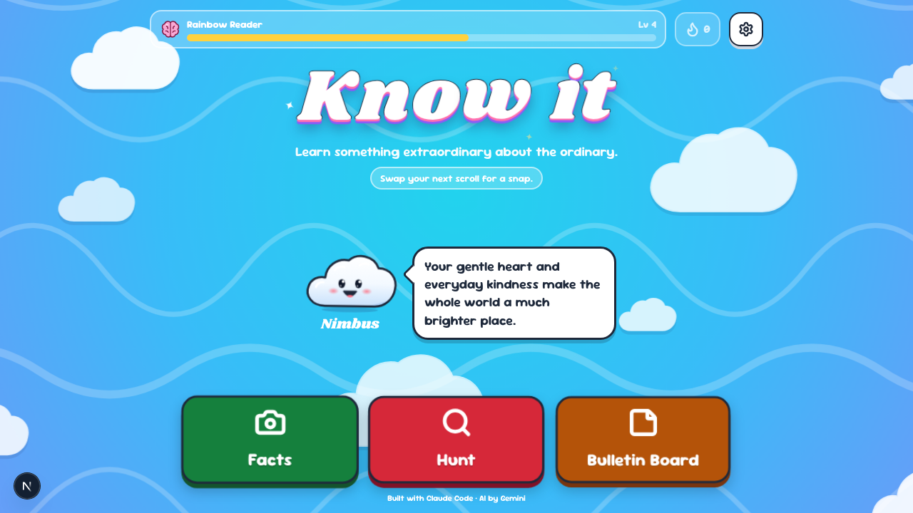
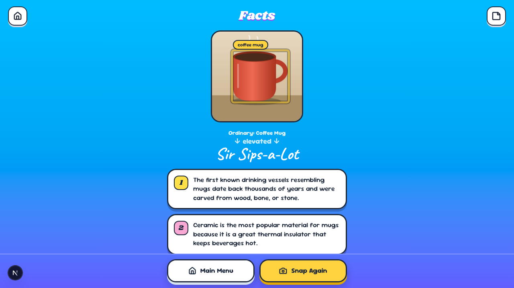
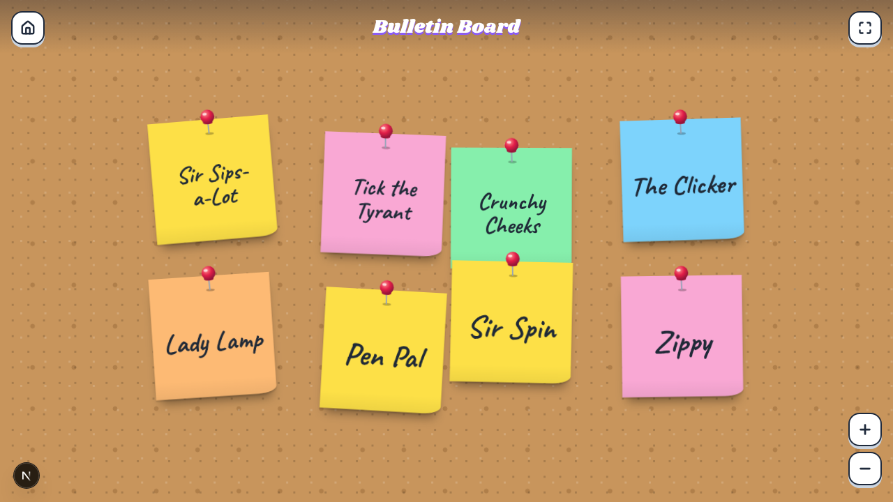
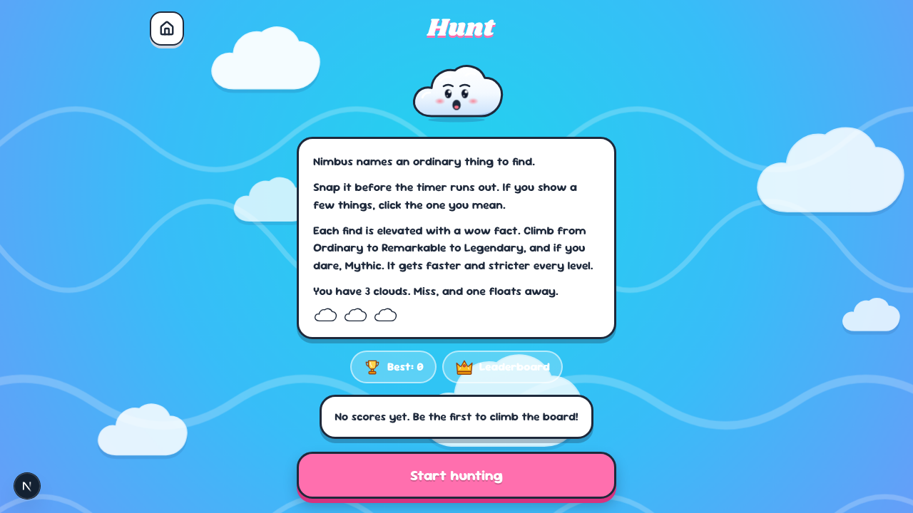
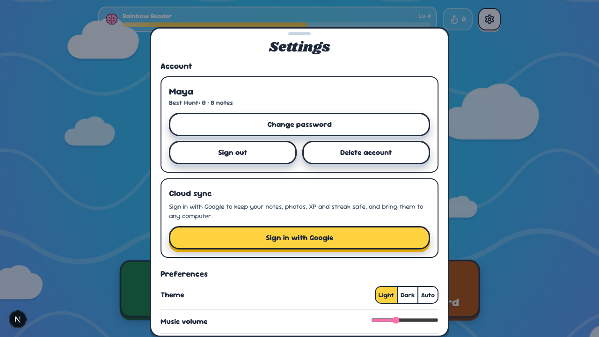

<div align="center">

# Know it

### Learn something extraordinary about the ordinary.
**Swap your next scroll for a snap.**

Bay Valley Hacks 2026 · Theme: *Elevate the Ordinary*

**[Try it live: knowitapp.vercel.app](https://knowitapp.vercel.app)** · Desktop web app · No install, no account needed



</div>

## The idea
I used to doomscroll: pick up the phone for a minute, look up an hour later, and remember nothing. Know it replaces that habit with something that gives a little curiosity back. Point your webcam at any everyday object (a mug, a stapler, a zipper) and an AI tells you the surprising story behind it, then pins it to a corkboard you can look back on. The things people ignore most are the things around them, and every one of them has a story.

## Try it in 60 seconds (for judges)
1. Open https://knowitapp.vercel.app in a desktop browser (Chrome, Edge, Firefox or Safari). Click **Click to start**, then **Skip for now** (or make a username to appear on the leaderboard).
2. **Facts:** allow the camera (or click the picture icon to upload a photo of anything). Watch the AI outline the object, name it, give it a nickname and reveal the facts, then answer the quiz.
3. **Bulletin Board:** open it to see your sticky note pinned. Scroll to zoom, drag notes around, click one to see its photo and facts, rename it, or share it as a card.
4. **Hunt:** start a round. Nimbus names an object, you have a countdown to snap it, and the AI judges your photo.

## Screenshots
| Facts: outline, nickname, facts, quiz | Bulletin Board |
| --- | --- |
|  |  |
| **Hunt** | **Settings and accounts** |
|  |  |

## What it does
- **Facts.** Snap with your webcam or upload a photo. Gemini finds and outlines the object, names it, and writes 5 to 10 facts that are checked against what you have already seen, so you never get the same fact twice. If it is unsure, it outlines the candidates and you click the right one. A quick A/B/C quiz follows, and a "Not that? Tell Nimbus what it really is" button lets you correct a wrong guess. Photos of people get friendly facts about clothing and surroundings, not about the person.
- **Bulletin Board.** Every object becomes a handwritten sticky note with an AI-made nickname ("Sir Sips-a-Lot" for a mug). The board is an infinite cork canvas: scroll to zoom, drag to pan, drag notes to rearrange, drag to the trash to unpin (with undo), rename, revert to the AI name, click a note to see its photo and facts, and share it as an image card.
- **Hunt.** A timed scavenger game. Nimbus names an object, you race to snap it. Rounds get faster (60 s shrinking 8% a round, 15 s floor) and stricter, climbing through Ordinary, Remarkable, Legendary and Mythic tiers. You have three clouds (lives), the clock pauses while the AI checks your photo, and each find earns a bonus fact.
- **Leaderboard and accounts.** Pick a username and password. Every username is screened by Gemini, passwords are hashed, and Hunt scores are ranked with gold, silver and bronze badges.
- **Progress.** XP and brain levels with a level-up celebration, daily streaks (click the flame for details), collection badges by category, and a "welcome back" card that remembers your last note.
- **Nimbus.** The cloud mascot gives AI compliments, guides the tutorial and reacts to what you do. Hand-drawn SVG art throughout, with no emojis.
- **Cloud sync.** Sign in with Google to keep notes, photos, XP, streak and settings safe and in sync across computers.
- **Made to be comfortable.** Light and dark themes, high contrast, text size, reduce motion, multiple languages for facts and compliments, kid / normal / nerdy fact styles, and an easier or harder Hunt start.
- **Polished details.** Looping music per screen with crossfades (only one open tab plays at a time), synthesized sound effects, cloud transitions between screens, offline support for visited screens, and an automatic "new version" banner.

## How it fits the theme
Everyday objects are the most overlooked things in our lives, and scrolling is the most overlooked use of our time. Know it elevates both. A paperclip becomes a story about invention, a mug becomes a piece of history, and a few idle minutes become something you actually remember.

## For the judging criteria
| Criterion | Where to look |
| --- | --- |
| Creativity and originality | Replacing doomscrolling with a curiosity habit; the nickname-and-sticky-note collection; Hunt as a game built on the same AI |
| Technical difficulty | Vision AI with bounding boxes drawn over the photo; strict JSON from an LLM with retries and model fallback; a custom pan, zoom and drag board using pointer events; hashed-password accounts with rate limiting; offline-first merge sync with Firestore; Web Audio crossfades with cross-tab ownership |
| Functionality | Full loop works end to end on the live site: account, Facts, board, Hunt, leaderboard, sync, settings |
| UI/UX | Consistent hand-drawn style, one-click flows, clear feedback and fallbacks (no camera, blocked camera, offline, AI errors) |
| Theme relevance | See above |
| Presentation | Demo video and this page |

## How it is built
```
Browser (Next.js App Router, React 19, Tailwind 4, GSAP)
  ├─ localStorage + IndexedDB ........ notes, photos, XP, settings (works offline)
  ├─ Firebase Auth + Firestore ....... optional Google sign-in and sync (merge rules in lib/client/sync-merge.ts)
  └─ /api routes (server only, the key never reaches the browser)
        ├─ detect, facts, compliment, hunt/challenge, hunt/check ... Gemini via its OpenAI-compatible endpoint
        └─ leaderboard/* ........... accounts, sessions and scores in Upstash Redis
```
- **AI.** `gemini-3.5-flash` writes facts; `gemini-3.5-flash-lite` handles detection, Hunt judging, username moderation and compliments. Responses are validated, retried once if the JSON is unreadable, and Facts falls back to the cheaper model if the main one is unavailable.
- **AI backup plan.** If a request fails because of credits, quota, a busy service or an unavailable model, the server tries the next option automatically: the other model on the same key, then the backup key (`GEMINI_API_KEY_BACKUP`) with both models. Bad requests are not retried. Open `/api/ai-status` to see which keys and models are working right now (it never shows a key).
- **Privacy.** Photos stay in your browser unless you sign in to cloud sync. A photo is sent to the AI only to analyze it.
- **Security.** scrypt password hashing, hashed session tokens (6 per account), lockout after 6 wrong passwords in 10 minutes, rate-limited API routes, Firestore rules that let each user touch only their own data.
- **Where things are.** `app/` routes and API, `components/` screens, `lib/client/` state, audio, sync and sharing, `lib/server/` Gemini, auth and the score store.

## Run it yourself
```bash
cp .env.example .env.local   # put your Gemini API key in GEMINI_API_KEY
npm install
npm run dev                  # http://localhost:3000
```
Other scripts: `npm run build`, `npm start`, `npm run lint`. In a Claude Code cloud session the key is injected by the network proxy: set `GEMINI_API_KEY=proxy-injected` and use `npm run dev:cloud`.

| Variable | Needed | What for |
| --- | --- | --- |
| `GEMINI_API_KEY` | yes | All AI features |
| `GEMINI_API_KEY_BACKUP` | optional, recommended | A second Gemini key (ideally from a different Google project). Used automatically if the first runs out of credits or is rate limited |
| `KV_REST_API_URL`, `KV_REST_API_TOKEN` (or `UPSTASH_REDIS_REST_URL`, `UPSTASH_REDIS_REST_TOKEN`) | for a shared leaderboard | Accounts and scores (Vercel adds them when you connect Upstash). Without them the leaderboard runs in a temporary in-memory mode |
| `NEXT_PUBLIC_FIREBASE_*` | optional | Use your own Firebase project for cloud sync |

**Deploy on Vercel:** import the repo (leave Root Directory empty), add `GEMINI_API_KEY`, connect an Upstash Redis store under Storage, and deploy. Pushes to `main` deploy automatically. The camera needs HTTPS.

## Challenges along the way
Getting a language model to return clean, structured data every time took retries, cleanup and a cheaper-model fallback. A first phone version fought with mobile audio and layout, so the final app focuses on a great desktop experience. Smaller fixes included two tabs playing music at once and stale cached builds.

## What is next
Bring Know it back to phones with proper device testing, share boards with friends, real-time Hunt races, daily challenges and themed collections, and teacher-made scavenger hunts.

## Credits
Built with Claude Code · AI by Gemini. Music via Storyblocks (Via Portugal, Joyful Ride, Courage, Fresh Story). Fonts: Shrikhand, Sour Gummy and Caveat (SIL Open Font License). Sound effects are synthesized in code.
